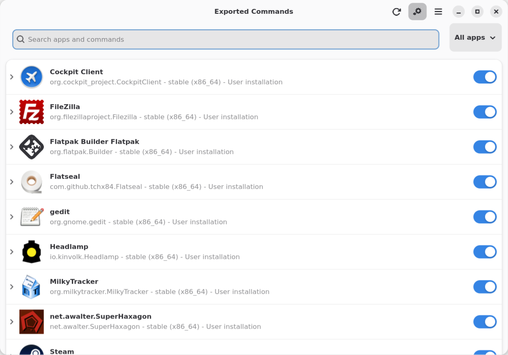

# Flatpak Command Exporter

**Make command-line tools shipped inside your Flatpaks available from your
terminal.**

Flatpak Command Exporter discovers commands declared by installed Flatpak
applications and creates small launchers in your user data directory. Use
**`flatshell`** to inspect and configure exports, or **Flatlink** to manage
aliases in a graphical interface.

> **Scope:** The exporter supports both user and system scopes. User
> configuration and launchers live under `${XDG_DATA_HOME:-$HOME/.local/share}`
> and system alias configuration lives under `/usr/lib/flatpak/aliases/`.
> System launchers are written to `/usr/share/flatpak-commands` when authorized.
> Flatlink and `flatshell` use a root-owned system-bus helper with PolicyKit
> authorization for system changes.

## What you can do

- Export commands declared in an app's Flatpak manifest, including
  `x-export-commands` and `export-commands`.
- Choose whether aliases are exported by default, then override that choice for
  individual apps or aliases.
- Add your own aliases for commands inside user- or system-installed Flatpaks.
- Search and toggle apps and aliases in Flatlink.
- Refresh user command exports from Flatlink after installing an app.
- Keep generated launchers on your `PATH` using the included profile script.

## Quick start

After installing the Debian packages, open a new login session so the profile
script can add user and system launcher directories to `PATH`. Then list
available aliases and export them:

```console
flatshell list --all
flatshell export
```

Run an exported command by its alias, just as you would run any other command:

```console
gimp
```

Use `flatlink` to browse and toggle aliases with the GUI. Settings changed in
either the GUI or the CLI are saved and the corresponding export scope is
refreshed.

## Install

### Debian package

The project builds two Debian packages: `flatpak-command-exporter` for the
library, CLI, and profile integration, and `flatpak-command-exporter-gui` for
Flatlink. To build both from a source checkout, install the build dependencies
listed in `debian/control`, then run:

```console
make deb
```

The resulting `.deb` files are written to the parent directory. Install the
core package and, if desired, the GUI package with your package manager. The
core package installs `flatpak-exported-commands.sh` into `/etc/profile.d/`;
start a new login session after installation for the `PATH` change to take
effect. Non-Debian installations can run `flatshell install-profile --user` to
set up shell integration for the current user, or `flatshell install-profile
--system` to install it in `/etc/profile.d/`. The system command is authorized
by the PolicyKit-backed system-bus helper. The user installation updates
`~/.profile` and applies to login shells that read that file.

### Fedora RPM

On Fedora 44 or 45, install the RPM build and project dependencies, then build
directly from the source checkout:

```console
sudo dnf install flatpak-devel gtk4 libadwaita make polkit \
  pyproject-rpm-macros python3-devel python3-gobject \
  python3-pip python3-setuptools rpm-build
make rpm
```

The spec derives its version from `pyproject.toml` and builds a core RPM plus
an optional `flatpak-command-exporter-gui` RPM. `rpmbuild` writes the packages
under `~/rpmbuild/RPMS/noarch/` by default.

### Development containers

The `.devcontainer/` directory includes configurations for Fedora 45 RPM in
`.devcontainer/fedora/`, Arch Linux PKGBUILD/makepkg in `.devcontainer/arch/`,
and Debian 13 (trixie) package development in `.devcontainer/debian-trixie/`.
In VS Code, reopen the repository in a container and choose the desired
configuration. The Debian container supports `make deb`; the Arch container
includes `base-devel` and `namcap`.

### Requirements

- Flatpak and Python 3.13 or newer.
- PyGObject and the Flatpak GObject introspection bindings for the CLI and
  exporter.
- System-scope operations use the system D-Bus and Polkit; the Debian core
  package installs the service and its authorization policy.
- GTK 4, libadwaita, and their introspection data to run Flatlink.

## CLI

The supported commands are `flatshell` for the CLI and `flatlink` for the GUI.

### Inspect and export

```console
# List aliases for a particular user-installed app
flatshell list org.gimp.GIMP

# List aliases for all discovered user and system refs
flatshell list --all

# Include the Flatpak command behind each alias
flatshell list --all --complete

# Generate or refresh enabled user launchers
flatshell export

# Generate or refresh system launchers (requests PolicyKit if needed)
flatshell export --system
```

### Configure defaults and apps

By default, aliases are enabled unless an app or alias has an explicit setting.
Set the global default to export all aliases or none:

```console
flatshell config default-export all
flatshell config default-export none
```

Enable or disable every alias for one app, or override a single alias:

```console
# App-level setting
flatshell enable org.gimp.GIMP
flatshell disable org.gimp.GIMP

# Alias-level setting
flatshell enable org.gimp.GIMP gimp
flatshell disable org.gimp.GIMP gimp
```

These settings affect the selected installation. Use `--user` for per-user
settings or `--system` for system settings; the system-bus helper requests
PolicyKit authorization.

### Add a custom alias

Custom aliases map a new command name to a command available inside an
installed Flatpak. Use `--system` to add an alias for a system-installed app;
system changes are handled by the system-bus helper with PolicyKit:

```console
flatshell add org.gimp.GIMP my-gimp gimp
flatshell add --system org.example.App my-command command
```

Remove a custom alias and disable that alias:

```console
flatshell remove org.gimp.GIMP my-gimp
flatshell remove --system org.example.App my-command
```

## Flatlink

Launch the GUI from the terminal with:

```console
flatlink
```



The window lists discovered apps in expandable rows, grouped by app and
installation scope. Each app has a switch for its default setting; individual
alias settings take precedence over the app and global defaults. Expand an app
to see each alias, its command, and its enable/disable switch. Use the search
field and the All/User/System filter to narrow the list. Changing a
system-installed app or alias requests PolicyKit authorization.

The global-default button controls whether new commands are exported by
default. Its scope is configured from **Settings** in the hamburger menu: it
can apply to both user and system installations (the default), or to user
installations only. System updates use PolicyKit authorization. The refresh
button exports all user commands, like `flatshell export`. The hamburger menu
opens Settings, which includes the About window with version and author
information from the project metadata. Changes to aliases and export defaults
refresh the generated launchers; changing the scope preference affects future
global default toggles. The core package installs the PolicyKit action and
system-bus helper.

## Configuration and files

User configuration is stored below:

```text
${XDG_DATA_HOME:-$HOME/.local/share}/flatpak/aliases/
├── global
└── <app_id>
```

System configuration is stored at:

```text
/usr/lib/flatpak/aliases/
├── global
└── <app_id>
```

Flatlink's global-default scope preference is stored in
`${XDG_CONFIG_HOME:-$HOME/.config}/flatpak/settings`. It applies to the
global-default button when toggled; `flatshell` commands that explicitly select
a scope continue to affect that scope. If the preference is absent, Flatlink
uses both user and system scopes.

```ini
[flatpak-command-exporter]
global-default-scope = user
```

The files use an INI/GKeyFile-style format. For example:

```ini
# global
[core]
default-export = none
```

```ini
# <app_id>
[app]
enabled = true

[aliases]
gimp = true
gimp-console = false

[custom-aliases]
my-gimp = gimp
```

Settings are resolved from most specific to least specific:

1. An alias setting in the app file.
2. The app-level `enabled` setting.
3. The global `default-export` policy.

`all` enables aliases by default; `none` disables them by default. An explicit
app or alias setting takes precedence over the less-specific setting.

Generated launcher scripts are stored in:

```text
${XDG_DATA_HOME:-$HOME/.local/share}/flatpak-commands/
/usr/share/flatpak-commands/
```

The profile script adds both user and system launcher directories to `PATH`.
Debian installs it in `/etc/profile.d/`; `flatshell install-profile --user`
installs a user copy and sources it from `~/.profile`.

## How it works

1. The exporter enumerates installed Flatpak app refs and reads their
   `files/manifest.json` command declarations. A built-in command map supplies
   aliases for known apps whose manifests do not declare them.
   The map includes GNOME and KDE Flathub apps with conventional host commands.
2. For each app, it combines the declared commands with custom aliases from
   that installation's configuration and applies the global, app, and alias
   settings.
3. For enabled aliases, it writes an executable launcher that invokes
   `flatpak run` with the app ID, branch, architecture, and command. Disabled
   launchers are removed from the export directory.
4. The profile script exposes that directory on `PATH`, so commands can be
   started directly from a terminal.

Flatlink and `flatshell` use the same configuration and export implementation,
so changing a setting in either interface produces the same result.

## Python library

The package can also be used from Python. `FlatpakCommandExporter` provides
methods to inspect aliases and command groups, refresh generated launchers, and
update export settings:

```python
from flatpak_command_exporter import FlatpakCommandExporter

exporter = FlatpakCommandExporter()
aliases = exporter.get_exported_aliases()
groups = exporter.get_command_groups(include_system=True)
exporter.set_alias_enabled("org.gimp.GIMP", "gimp", True)
```

The `set_*` and `add_custom_alias` methods save settings and refresh generated
launchers. `remove_custom_alias` removes the custom alias, disables it, and
refreshes exports. A custom `AliasConfig` can be passed to the constructor to
control the configuration location. The library requires Flatpak and
PyGObject with Flatpak introspection bindings; GTK is only needed for Flatlink.

## Development

Run the test suite from a source checkout:

```console
python -m unittest discover -s tests -v
```

Build the Debian packages with `make deb`. The test suite covers configuration
precedence and persistence, CLI compatibility, launcher generation, library
operations, and Flatpak alias discovery.

Update the Debian, RPM spec, and AppStream release changelogs together with
`make release`. The individual `make changelog`, `make spec`, and
`make metainfo` targets can also be run separately. Set `SOURCE_DATE_EPOCH` to
choose a reproducible date for new entries.

## Recent changes

- Added per-user global and per-app alias configuration in
  `flatpak/aliases/`.
- Added app and alias enable/disable settings, default export policies, and
  custom aliases.
- Added the `flatshell` CLI configuration commands and Flatlink controls,
  including app-level defaults, a scope-aware global-default button, export
  refresh, and About window.
- Updated Debian packaging to install the renamed profile script
  automatically.
- Kept the existing application ID prefix, `xyz.kowalski7cc`, and standardized
  the GUI command name as lowercase `flatlink`.

## License

Flatpak Command Exporter is distributed under the MIT License. See
[LICENSE](LICENSE) for the full text.
